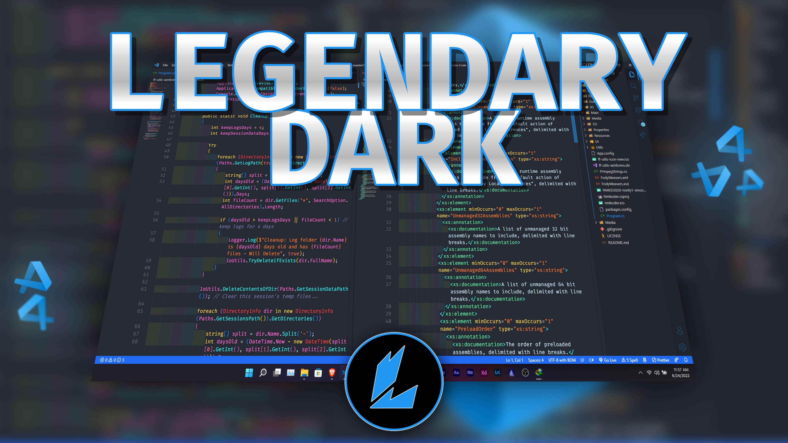

# Legendary Dark - VS Code and Zed theme

   

# **Legendary Dark**

**This theme works best with Bracket pair colorizer and indent-rainbow all VS Code Extensions which can be found in the store.**

**This theme includes the dark goodness of Andromeda and the color syntax of synthwave '84.**

---
## Zed

Legendary Dark now includes a Zed theme file at `themes/legendary-dark.json` and a Zed extension manifest at `extension.toml`.

The Zed extension ID is `legendary-dark`.

### Install as a Zed dev extension

1. Open the command palette in Zed.
2. Run `zed: install dev extension`.
3. Select this repository folder.
4. Choose `Legendary Dark` from the theme selector.

### Install as a local Zed theme

Copy `themes/legendary-dark.json` to your Zed themes directory:

- Windows: `%USERPROFILE%\AppData\Roaming\Zed\themes\`
- macOS/Linux: `~/.config/zed/themes/`

Restart Zed if the theme does not appear immediately, then choose `Legendary Dark` from the theme selector.

### Publish to Zed

See `ZED_PUBLISHING.md` for the registry submission steps.

---
## License:
[MIT](https://github.com/Llewellyn500/Legendary-Dark/blob/master/LICENSE.md)
